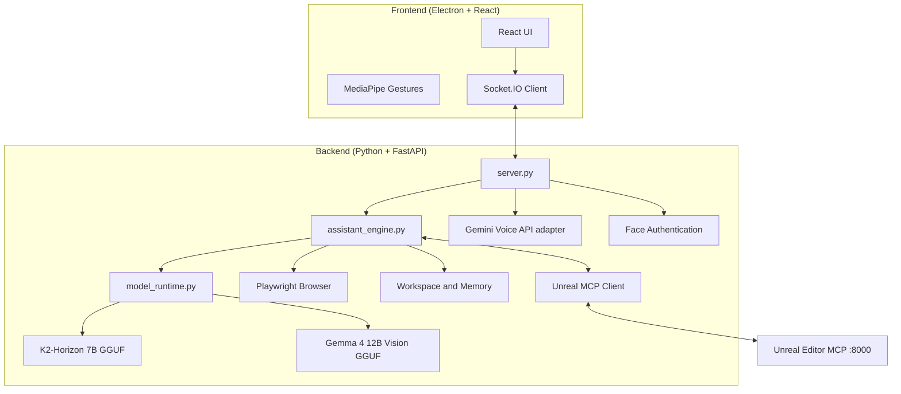

# A.D.A V2 - Advanced Design Assistant


> **A.D.A** = **A**dvanced **D**esign **A**ssistant

A.D.A v2 is a single Electron development assistant. Its primary conversation and coding model runs locally from GGUF files; a separately registered vision model can be loaded on demand for image analysis. A.D.A manages the inference runtime, browser, workspace tools, and project history from one interface.

---

## 🌟 Capabilities at a Glance

| Feature | Description | Technology |
|---------|-------------|------------|
| **🧠 Local Development Model** | Coding, reasoning, tool use, and project work | K2-Horizon 7B GGUF + managed llama.cpp |
| **👁️ Vision Delegation** | Primary model requests image inspection; findings return to the same chat | Gemma 4 12B GGUF + mmproj |
| **🗣️ Voice** | API-backed speech input and output (local voice runtime removed) | Gemini Voice API (adapter pending) |
| **🖐️ Minority Report UI** | Gesture-controlled window manipulation | MediaPipe Hand Tracking |
| **👁️ Face Authentication** | Secure local biometric login | MediaPipe Face Landmarker |
| **🌐 Browser Automation** | Primary model navigates, clicks, types, reads, and captures pages | Playwright + Chromium |
| **🕹️ Unreal Editor Control** | Primary model discovers and invokes the running editor's tools | Existing Unreal MCP server (Streamable HTTP) |
| **📁 Development Workspace** | Open an existing repository, inspect/edit files, search source, run approved commands | Workspace-scoped tools + project history |

### 🖐️ Gesture Control Details

ADA's "Minority Report" interface uses your webcam to detect hand gestures:

| Gesture | Action |
|---------|--------|
| 🤏 **Pinch** | Confirm action / click |
| ✋ **Open Palm** | Release the window |
| ✊ **Close Fist** | "Select" and grab a UI window to drag it |

> **Tip**: Enable the video feed window to see the hand tracking overlay.

---

## 🏗️ Architecture Overview



---

## ⚡ TL;DR Quick Start (Experienced Developers)

<details>
<summary>Click to expand quick setup commands</summary>

```bash
# 1. Clone and enter
git clone --branch feature/ada-development-assistant-strip https://github.com/EnterraInteractive/ada_v2.git && cd ada_v2

# 2. Create the project-local Python environment, caches, and browser runtime
powershell -ExecutionPolicy Bypass -File scripts\setup_local.ps1

# 3. Configure Gemini Live API voice (optional)
# Copy .env.example to .env and set GEMINI_API_KEY in .env
# Keep .env private; it is excluded from Git.

# 4. Setup frontend
npm install


# 5. Run!
npm run dev
```

</details>

---

## 🛠️ Installation Requirements

### 🆕 Absolute Beginner Setup (Start Here)
If you have never coded before, follow these steps first!

**Step 1: Install Visual Studio Code (The Editor)**
- Download and install [VS Code](https://code.visualstudio.com/). This is where you will write code and run commands.

**Step 2: Install Python 3.11 (The Runtime)**
- Install Python 3.11 for Windows and ensure the Python Launcher (`py`) is available.
- A.D.A creates its own `.venv` inside the repository; Python packages are installed there instead of a global or Conda environment.

**Step 3: Install Git (The Downloader)**
- **Windows**: Download [Git for Windows](https://git-scm.com/download/win).
- **Mac**: Open the "Terminal" app (Cmd+Space, type Terminal) and type `git`. If not installed, it will ask to install developer tools—say yes.

**Step 4: Get the Code**
1. Open your terminal (or Command Prompt on Windows).
2. Type this command and hit Enter:
   ```bash
   git clone --branch feature/ada-development-assistant-strip https://github.com/EnterraInteractive/ada_v2.git
   ```
3. This creates a folder named `ada_v2`.

**Step 5: Open in VS Code**
1. Open VS Code.
2. Go to **File > Open Folder**.
3. Select the `ada_v2` folder you just downloaded.
4. Open the internal terminal: Press `Ctrl + ~` (tilde) or go to **Terminal > New Terminal**.

---

### ⚠️ Technical Prerequisites
Once you have the basics above, continue here.

### 1. System Dependencies

**MacOS:**
```bash
```

**Windows:**
- No additional system dependencies required!

### 2. Python Environment
From the repository root, create the project-local `.venv`, install Python dependencies, and download Chromium into `.ada`:

```powershell
powershell -ExecutionPolicy Bypass -File scripts\setup_local.ps1
```

The script places Python packages in `.venv`, pip/Hugging Face caches in `.ada\cache`, and Playwright Chromium in `.ada\browsers`.

### 3. Frontend Setup
Requires **Node.js 18+** and **npm**. Download from [nodejs.org](https://nodejs.org/) if not installed.

```bash
# Verify Node is installed
node --version  # Should show v18.x or higher

# Install frontend dependencies
npm install
```

### 4. 🔐 Face Authentication Setup
To use the secure voice features, ADA needs to know what you look like.

1. Take a clear photo of your face (or use an existing one).
2. Rename the file to `reference.jpg`.
3. Drag and drop this file into the `ada_v2/backend` folder.
4. (Optional) You can toggle this feature on/off in `settings.json` by changing `"face_auth_enabled": true/false`.

---

## ⚙️ Configuration (`settings.json`)

The system creates a per-machine `settings.local.json` file from the tracked defaults on first run. It is ignored by Git. The Enterra setup defaults to `E:/Unreal Projects/EnterraOnline`.

| Key | Type | Description |
| :--- | :--- | :--- |
| `face_auth_enabled` | `bool` | If `true`, blocks all AI interaction until your face is recognized via the camera. |
| `tool_permissions` | `obj` | Controls manual approval for specific tools. |
| `tool_permissions.run_terminal_command` | `bool` | If `true`, requires approval before running a shell command. |
| `tool_permissions.write_file` | `bool` | Requires approval before A.D.A writes code/files to disk. |

---

### 6. 🕹️ Connect the Unreal Editor

A.D.A is an MCP **client**. It connects to the Unreal MCP server already running inside your Unreal Editor; it does not create another MCP server.

1. Start the Unreal Editor with the existing Unreal MCP plugin/server enabled.
2. Confirm its Streamable HTTP endpoint is `http://127.0.0.1:8000/mcp`.
3. Open A.D.A **Settings → Unreal Editor Connection** and keep that endpoint enabled.
4. Save the setup. A.D.A discovers the editor tools and exposes them to K2 as `unreal_*` tools. MCP-annotated read-only queries can run automatically; editor changes and actions require confirmation by default.
5. If the editor starts after A.D.A, press **Reconnect** in Settings.

A.D.A's own backend listens on `127.0.0.1:8001`; port 8000 remains available for the Unreal MCP server. Screenshots returned by Unreal MCP can be passed to Gemma through `analyze_image`.

### 7. 🧠 Configure the Local Model Runtime
A.D.A loads llama.cpp directly into its own Python backend through `llama-cpp-python`. There is no `llama-server.exe`, model HTTP server, Ollama, Docker, or separate inference process.

1. Install the NVIDIA CUDA 13.x Toolkit for the RTX 5070 if it is not already installed.
2. Install the application dependencies with `powershell -ExecutionPolicy Bypass -File scripts\setup_local.ps1`.
3. Build the K2-compatible embedded inference runtime with `powershell -ExecutionPolicy Bypass -File scripts\ai\install_k2_runtime.ps1`. This builds `llama-cpp-python` against upstream llama.cpp b11454 with CUDA for the RTX 5070 (`sm_120`).
4. Download the default Q4_K_M K2-Horizon GGUF directly into the project with `.venv\Scripts\python.exe scripts\ai\download_k2_model.py`, or place your existing GGUF at `models/language/k2-horizon-7b/model.gguf`.
5. Verify the native K2 loader with `.venv\Scripts\python.exe scripts\ai\verify_k2_runtime.py`.
6. Obtain the Gemma 4 12B Instruct GGUF and its matching multimodal projector, then place them at `models/vision/gemma-4-12b/model.gguf` and `models/vision/gemma-4-12b/mmproj.gguf`.
7. Start A.D.A and open **Settings → Local Model Runtime**. The project-relative paths are preconfigured; use the file pickers only if you keep different filenames or locations.
8. Confirm K2 is the primary model and Gemma 4 is the vision delegate, then save.
9. Confirm the Enterra Online workspace under **Development Workspace**; its default is `E:/Unreal Projects/EnterraOnline`.

**Runtime behavior**
- Only one model is loaded at a time. When K2 requests image analysis, A.D.A unloads K2, loads Gemma 4, passes the actual image bytes, returns Gemma's findings to the same conversation, and reloads K2 for the next response.

The K2 profile defaults to a 65,536-token context and 32,768-token output, with Q8 KV cache kept in system RAM to protect the 12 GB GPU memory. This trades some speed for context capacity. The context size and GPU-layer settings can be adjusted in the model registry. Change `cache_type_k`, `cache_type_v`, or `no_kv_offload` in `settings.local.json` if you want to tune the KV cache placement. The standard PyPI llama-cpp-python wheel does not include K2-Horizon support; use the project installer above. Run `.venv\Scripts\python.exe scripts\ai\verify_k2_runtime.py --full --tool-test` to test real GPU generation and parsed tool calls.

**K2 tool calling:** upstream llama.cpp b11454 adds K2-Horizon reasoning and tool-call support. A.D.A configures high reasoning effort and JSON tool formatting, and includes a local GPU/function-call verifier. After that passes, the actual Unreal Editor and browser tools still need an end-to-end smoke test in your environment.
- Model paths, context sizes, GPU layers, and model roles are configurable. Additional GGUF models can be added to the registry.
- The active model and runtime readiness are shown in the A.D.A status bar.
- Use a Q4 quantization as a practical starting point on a 12 GB GPU. The default Gemma context is deliberately conservative (8K) and can be adjusted in Settings. Start with Q4_K_M on the 12 GB GPU; use Q4_0 if you need more VRAM headroom. The BF16 vision projector is about 175 MB.

**Model references**
- [K2-Horizon 7B GGUF](https://huggingface.co/IFM/K2-Horizon-7B-GGUF)
- [Gemma 4 12B Instruct GGUF + mmproj](https://huggingface.co/ggml-org/gemma-4-12B-it-GGUF)
- [llama-cpp-python](https://github.com/abetlen/llama-cpp-python) (in-process Python bindings)

**Gemini Live API voice**
- A.D.A streams microphone audio to Gemini Live API and plays its streamed native-audio responses. The backend uses the Google GenAI Python SDK; no local Whisper or TTS model is loaded.
- Copy `.env.example` to `.env` in the A.D.A project root and set `GEMINI_API_KEY=your_key`. The backend loads this file automatically. Never commit `.env`.
- The default voice model is `gemini-3.8-live`; override it with `GEMINI_LIVE_MODEL` if needed.
- Enable **Gemini Live API Voice** in Settings and save. Start the voice session with the microphone control. Voice is API-backed and independent of local K2/Gemma inference.
- Input audio is sent as 16 kHz PCM and output audio is played as 24 kHz PCM. Provider metadata is stored under `models/voice/gemini/`; no local voice weights are required.
### Option 1: The "Easy" Way (Single Terminal)
The app is smart enough to start the backend for you.
1. Open your terminal in the `ada_v2` folder.
2. Run:
   ```bash
   npm run dev
   ```
4. The backend will start automatically in the background.

### Option 2: The "Developer" Way (Two Terminals)
Use this if you want to see the Python logs (recommended for debugging).

**Terminal 1 (Backend):**
```bash
.venv\Scripts\python.exe backend\server.py
```

**Terminal 2 (Frontend):**
```bash
# Environment doesn't matter here, but keep it simple
npm run dev
```

---

## ✅ First Flight Checklist (Things to Test)

1. **Local Chat Check**: Select K2-Horizon and send a message in the chat panel.
2. **Workspace Check**: Open your repository folder in Settings and ask A.D.A to list its files.
3. **Vision Check**: Turn on the camera and ask A.D.A to inspect the current frame.
4. **Browser Check**: Ask A.D.A to open a page, read it, and summarize it.
---

## ▶️ Commands & Tools Reference

### 🧠 Development Commands
- "Inspect the active repository and explain its architecture."
- "Find all references to [symbol] and update the implementation."
- "Run the project build and fix the errors."
- "Use the browser to research [topic] and summarize it."
- "Analyze the current camera frame."


## ❓ Troubleshooting FAQ

### Camera not working / Permission denied (Mac)
**Symptoms**: Error about camera access, or video feed shows black.

**Solution**:
1. Go to **System Preferences > Privacy & Security > Camera**.
2. Ensure your terminal app (e.g., Terminal, iTerm, VS Code) has camera access enabled.
3. Restart the app after granting permission.

---

### Local model does not start
**Symptoms**: A.D.A reports that the embedded inference runtime is unavailable, a GGUF file is missing, or the model fails to load.

**Solution**:
1. Run `.venv\Scripts\python.exe scripts\ai\verify_k2_runtime.py` to confirm the installed native backend recognizes the K2 GGUF.
2. If the K2 backend is missing or has no GPU support, run `powershell -ExecutionPolicy Bypass -File scripts\ai\install_k2_runtime.ps1` from the project root.
3. Verify the selected K2/Gemma GGUF paths and Gemma mmproj path in Settings.
4. Check the A.D.A backend console for the native runtime or CUDA loading error.
5. Run `.venv\Scripts\python.exe scripts\ai\verify_k2_runtime.py --full --tool-test` to isolate generation and tool-call issues before testing the full app.


## 📸 What It Looks Like

*Coming soon! Screenshots and demo videos will be added here.*

---

## 📂 Project Structure

```
ada_v2/
├── backend/                    # Python server & AI logic
│   ├── assistant_engine.py     # Local development assistant and tools
│   ├── model_runtime.py        # In-process llama-cpp-python GGUF inference
│   ├── server.py               # FastAPI + Socket.IO server
│   ├── web_agent.py            # Playwright browser automation
│   ├── unreal_mcp.py           # Client for the existing Unreal Editor MCP server
│   ├── authenticator.py        # MediaPipe face auth logic
│   ├── project_manager.py      # Project context management
│   └── reference.jpg           # Your face photo (add this!)
├── models/                     # Project-local model registry, GGUF folders, Gemini voice provider metadata
│   ├── language/k2-horizon-7b/
│   ├── vision/gemma-4-12b/
│   └── voice/gemini/
├── src/                        # React frontend
│   ├── App.jsx                 # Main application component
│   ├── components/             # UI components (9 files)
│   └── index.css               # Global styles
├── electron/                   # Electron main process
│   └── main.js                 # Window & IPC setup
├── projects/                   # User project data (auto-created)

├── requirements.txt            # Python dependencies
├── package.json                # Node.js dependencies
└── README.md                   # You are here!
```

---

## ⚠️ Known Limitations

| Limitation | Details |
|------------|---------|
| **macOS & Windows** | Tested on macOS 14+ and Windows 10/11. Linux is untested. |
| **Camera Required** | Face auth and gesture control need a working webcam. |
| **Network Dependency** | Local text/code inference runs offline after model files are available; browser tasks require network access. |
| **Single User** | Face auth recognizes one person (the `reference.jpg`). |

---

## 🤝 Contributing

Contributions are welcome! Here's how:

1. **Fork** the repository.
2. **Create a branch**: `git checkout -b feature/amazing-feature`
3. **Commit** your changes: `git commit -m 'Add amazing feature'`
4. **Push** to the branch: `git push origin feature/amazing-feature`
5. **Open a Pull Request** with a clear description.

### Development Tips

- Run the backend separately (`.venv\Scripts\python.exe backend\server.py`) to see Python logs.
- Use `npm run dev` without Electron during frontend development (faster reload).
- The `projects/` folder contains user data—don't commit it to Git.

---

## 🔒 Security Considerations

| Aspect | Implementation |
|--------|----------------|
| **API Keys** | No API key is required for local inference, voice, or workspace tools. |
| **Face Data** | Processed locally, never uploaded. |
| **No Cloud Storage** | All project data stays on your machine. |

> [!WARNING]
> Never share your `reference.jpg` file. It contains biometric data.

---

## 🙏 Acknowledgments

- **[llama.cpp](https://github.com/ggml-org/llama.cpp)** — Managed local GGUF inference
- **[K2-Horizon](https://huggingface.co/IFM/K2-Horizon-7B-GGUF)** — Primary development model
- **[Gemma 4](https://huggingface.co/ggml-org/gemma-4-12B-it-GGUF)** — Vision delegation
- **[MediaPipe](https://developers.google.com/mediapipe)** — Hand tracking, gesture recognition, and face authentication
- **[Playwright](https://playwright.dev/)** — Reliable browser automation

---

## 📄 License

This project is licensed under the **MIT License** — see the [LICENSE](LICENSE) file for details.

---

<p align="center">
  <strong>Built with 🤖 by Nazir Louis</strong><br>
  
</p>
